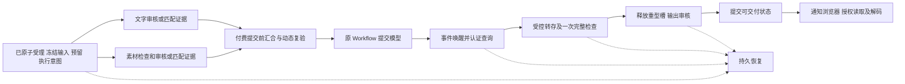

# 生成链路性能复核：从必要依赖重新设计

日期：2026-10-22，Asia/Shanghai。

基线：`3383e74474125d8242731d728df92c9f4ecac901` 加当前工作区上一轮未提交的优化。本文是源码审计和现有本地记录的重新计算，不是新实现、线上测量或发布验收。业务代码保持原状。

**结论：还有明确的结构性优化空间，现有证据不足以声称已经接近最短时间。** 上一轮删除重复媒体读取、合并视频提交、消费同步审核结果、同 Workflow 继续执行，都有实际价值。剩余重点是异步完成通知、数据库交互次数、执行槽的占用范围，以及独立工作的真正并行。

## 先定义需要最小化的量

用户等待的是“提交到首个经过授权、审核并实际解码的结果”，还应单独测量上传开始到结果可见。提前处理上传可以缩短点击后的等待，但不能把同一工作移到计时起点之前，就宣布总工作量下降。

总时间由依赖图中最长的一条路径决定。可以压缩的是：不产生新事实的重复读取、不保护新边界的重复交接、已有事实等待被发现的空档，以及没有依赖关系却被串行执行的工作。

保留三个必要事实边界：

1. 供应商付费提交之前，冻结输入和价格、完成必要审核、原子预留积分并持久化执行意图；提交身份在重试中保持不变。
2. 私有结果交付之前，确认供应商真实结果，完成必要字节检查和内容审核，将对象身份和业务状态可靠绑定。
3. 对不可撤销的操作，保存足够的重放、租约和不确定状态证据。外部 HTTP 与 PostgreSQL 无法组成一个普通数据库事务，不能把这些证据一并删除。

在这些约束内，理想输入阶段为 `max(文字审核, 素材检查及审核, 资格准备)` 加最终原子复验；不是把所有步骤相加。完整结果不能在审核前显示，动态余额、退款、删除和停用状态也不能用过期缓存替代。

## 当前证据能说明什么

本轮重新读取上一轮的原始 JSON 和 workerd 日志，并用脚本核对一个模型尝试、一次源图下载、两次审核、一次积分预留和一次结算。计算摘要及源码哈希见 [证据 JSON](D:/AIProject/Gefei/SaaSTool/ez-image-ai/docs/operations/evidence/generation-performance-first-principles-2026-10-22.json)。

| 已有本地场景           | 点击至模型受理 | 模型实际运行 | 模型完成至图片可见 |     总计 |
| ---------------------- | -------------: | -----------: | -----------------: | -------: |
| 同步审核、维护槽空闲   |        3.536 s |      1.507 s |            4.390 s |  9.433 s |
| 异步审核、没有审核回调 |        9.387 s |      1.508 s |           10.599 s | 21.494 s |
| 异步审核、有审核回调   |        7.518 s |      1.513 s |            8.011 s | 17.042 s |

异步审核夹具每次固定处理 3.5 秒。没有审核回调时，输入审核完成后到认证查询还等了 **2.570 秒**，输出审核还等了 **3.067 秒**，合计 **5.637 秒**。有回调的记录中，这两个间隔分别为 358 ms 和 343 ms。回调确实减少了这个样本中的发现延迟，但这些各一次的运行不是严格配对的性能实验，不能用两次总时长差作为生产提速承诺。

同步审核场景也有 7.926 秒非模型时间，其中仍包括必要的审核、存储和网络操作，不能全部当成可以删除的开销。日志进一步显示：输入审核完成后的数据库收尾耗时 772 ms；输出审核相同阶段耗时 847 ms。这是该函数阶段的墙钟时间，尚未拆成 SQL 执行、连接等待、锁等待与本地运行时开销。

证据有四个关键限制：

- 这些样本输出只有 **68 字节**，不能代表真实图片或视频的传输、解码和内存表现。
- 测试浏览器每 **250 ms** 查状态；实际图片和视频可见页通常每 **2 秒**查询。不能将这个最小测试页面的时间当作完整产品体验。
- 每个场景只有一条记录，缺乏同环境旧/新制品对照，无法计算可靠的 P50/P95 或生产收益。
- 现有 `FlowTiming` 的 `connectionWaitMs`、`sqlExecutionMs` 都是 `null`。后续观察到的资产 `updatedAt` 也不能替代 READY 状态真正提交的时间。

## 确认的剩余问题与改造方向

### 1. 图生视频输入审核仍可能等待默认 30 秒的查询间隔

[submission.ts:306](D:/AIProject/Gefei/SaaSTool/ez-image-ai/packages/jobs/src/video-v1/submission.ts:306) 调用 `submitImage` 时没有传 `callbackUrl`；异步返回后在第 336 行使用 `moderationPollSeconds`。该配置默认 30 秒，当前 readiness 还拒绝小于 15 秒的值，见 [video-v1.ts:109](D:/AIProject/Gefei/SaaSTool/ez-image-ai/packages/config/video-v1.ts:109)。原有 SeeAPI 视频回调数据库入口限定在 `OUTPUT_REVIEW`，上一轮的 legacy 图片回调也不能直接当作这条 native video 输入路径的回调。

例如首次查询仍 PENDING，而服务在第 3.5 秒完成；如果这段期间没有其他有效唤醒，下一次查询约在第 30 秒才发生，多出的约 26.5 秒是示意推算，不是线上测量。生产是否覆盖默认配置尚未验证。

**改造：** 给视频输入图片审核增加专用的、绑定 job/输入身份/审核代次的签名回调；先持久化通知，再向原 `VIDEO_WORKFLOW` 发事件，经过租约和预算控制的认证查询后记录结果。保留无回调情况下的有界查询与恢复。不要直接把配置改成每秒轮询：这既没有消除依赖问题，还可能被当前配置校验拒绝，并提高供应商和数据库负担。

### 2. 数据库的“并行”外观掩盖了串行网络往返

[client.ts:20](D:/AIProject/Gefei/SaaSTool/ez-image-ai/packages/database/prisma/client.ts:20) 为 Workers 请求/任务创建 `max: 1` 的连接池。该客户端上的多条 `Promise.all` 查询仍要等待同一条连接；事务内部也不能通过扩大连接池把操作变成并行。

更大的问题在 [video-v1-execution.ts:55](D:/AIProject/Gefei/SaaSTool/ez-image-ai/packages/database/prisma/queries/media/video-v1-execution.ts:55)：`lockedContext` 加锁后加载 job、execution、模板、attempts、assets、reservation 的完整关系。输入审核多次调用 `recordVideoInputReview`，每次又进入同样的事务和关系加载。Prisma 的一次关系查询调用也不等于一次 SQL 往返。

**改造：** 按业务阶段缩小投影；用条件更新及 `RETURNING` 返回下一步所需状态；将同一事实提交中的 evidence、状态变更、后继意图合并进同一事务；将独立资格读取整理成一条有索引支撑的 SQL/CTE 或少量专用查询。图片合并提交内部仍先写 quote、再写 job，可参考已经合并的视频路径，在保留独立报价入口的同时合并真正提交的持久化。

先统计实际 SQL 数和锁等待，再选择少量需要并行的非事务读取是否值得增加连接。不要全局调大连接池。模板引用权限、退款、账户锁后的余额检查和供应商提交前的状态检查属于不同事实边界，不能用之前读到的值直接替代。

### 3. 图片仍在为每一阶段重复领取、交接与重新装载上下文

[orchestrator.ts:261](D:/AIProject/Gefei/SaaSTool/ez-image-ai/apps/workflows/src/orchestrator.ts:261) 的常规后继仍是：控制槽 `prepare` → 原 Workflow → 目标执行槽 → 续租/验证 → 业务 handler → ACK → 查询后继。两个执行调用各自创建数据库客户端，见 [workers.ts:90](D:/AIProject/Gefei/SaaSTool/ez-image-ai/apps/workflows/src/workers.ts:90)。

另外，[图片审核回调](D:/AIProject/Gefei/SaaSTool/ez-image-ai/packages/api/modules/media/webhooks/image-moderation-callback.ts:54) 和 [Kie 回调](D:/AIProject/Gefei/SaaSTool/ez-image-ai/packages/api/modules/media/webhooks/kie-callback.ts:60) 仍通过 `dispatchJob` 创建独立唤醒任务。同步审核样本日志中出现两个 Workflow run ID；启用审核回调的样本有四个。这不表示重复生成，却会增加调度和数据库竞争。

**改造：** 新请求采用版本化的直接图片 Workflow，阶段直接调用共享业务操作；一次已提交的状态推进返回足够的后继状态，只在真正等待外部服务或资源时退出执行。Outbox 继续承担可靠恢复和必要的异步交付，不必让每个正常阶段都走完整通用投递协议。回调优先唤醒数据库绑定的原 Workflow，旧实例/缺失映射保留现有恢复路径。

必须保留已接受的旧 Workflow、回执接收器和 uncertainty 语义。不能只删 prepare 的续租检查而继续使用可能过期的旧 receipt；应在容量准入后原子领取有效租约。Cloudflare 要求 Hyperdrive 连接在各自 step 内创建和使用，优化方向是减少不必要的 step/往返，不能跨 step 共用 socket。

### 4. 唯一重型执行槽还承担首次审核及数据库收尾

[runtime.ts:4467](D:/AIProject/Gefei/SaaSTool/ez-image-ai/packages/jobs/src/runtime.ts:4467) 在转存后仍直接 `await verification.verify(assetId)`。只有返回 PENDING 后的续查才转到控制槽；首次审核 POST、可能的 GET 和状态写入仍在重型 handler 中。

[worker-executors.ts:7](D:/AIProject/Gefei/SaaSTool/ez-image-ai/packages/jobs/src/orchestration/worker-executors.ts:7) 将 `jobs-primary` 固定为一个槽。同步审核样本的 finalization 占槽 3856 ms，其中审核本体阶段为 1372 ms。这个单样本比例不能当成吞吐量提升测量，但它证明占槽期间包含可以交给控制执行的工作。容量不足时 [orchestrator.ts:176](D:/AIProject/Gefei/SaaSTool/ez-image-ai/apps/workflows/src/orchestrator.ts:176) 还固定睡眠 5 秒，槽释放后也可能继续空等。

**改造：** 重型槽只负责需要受内存约束的读取、转换、检查和写入；持久化转存身份后立即释放，将首次审核也交给控制阶段。容量释放以事件通知排队者，数据库/执行器仍校验真实占用和租约，超时作为兜底。单用户路径要避免为了释放资源额外增加一串 prepare/查询，需与第 3 项一起设计。

保留重型上限 1；不同 Durable Object 不等于独立内存 isolate，不能未经内存和部署隔离验证就用分片名称扩大容量。

### 5. 视频文字审核与图片审核没有实际数据依赖，却被串行化

[submission.ts:258](D:/AIProject/Gefei/SaaSTool/ez-image-ai/packages/jobs/src/video-v1/submission.ts:258) 先写审核上下文、等待 Waffo、写文字结果，再开始图片审核。对同一个已冻结请求，这两个检测互不需要对方的结果。

**改造：** 完成身份和预算检查后，两路外部审核有限并行；分别保存可信结果和不确定受理状态，汇合点要求两者有效通过。可将独立的素材审核提前到封存上传完成之后，与用户编写提示词重叠。复用条件必须包含对象身份、审核规则、权限与有效期，不能跨规则复用，或给旧视觉证据续期。

这样可将两路服务的串行和变为最大值，理论节省较短一路耗时。代价是文字最终拒绝或用户放弃时，图片审核可能已花费费用；应配置每账户预算、去重和短时预处理限制。模板必须等场景图生成并审核后才可生成最终视频，这条真实依赖不能删除。

### 6. 视频传输还包含恢复前置和串行分片

[output-storage.ts:266](D:/AIProject/Gefei/SaaSTool/ez-image-ai/packages/jobs/src/video-v1/output-storage.ts:266) 每次 fresh transfer 先列出并清理不完整 multipart，再取供应商流、建立 multipart、逐片上传、完成、HEAD。`completeMultipartUpload` 丢弃返回元数据，后面重新 HEAD 获取最终身份。[stream-copy.ts:79](D:/AIProject/Gefei/SaaSTool/ez-image-ai/packages/storage/lib/stream-copy.ts:79) 等待一个分片上传结束后才继续拉取应用层流。

**改造：** 使用持久 transfer identity 区分“确定从未开始”和“恢复/未知”路径。新建路径跳过只为恢复服务的清理，恢复按已记录 upload ID 精确处理，保持配额和清理保证。评估有界双缓冲流水传输；在允许的内存预算内让下载、检查、上传重叠。若平台完成响应能可靠返回同一不可变对象的充分身份，使用该回执减少重复 HEAD；这项必须先证明平台语义，不能直接删除检查。

Workers 可评估原生 R2 binding 存储适配器，Node/MinIO 保留 S3 适配器。条件写、冲突 winner、ETag、Range、校验和、失败关闭流及 multipart 恢复必须保持等价。此项收益依文件大小和网络而变，68 字节图片样本无法估算。

### 7. 内部调度仍经 HTTP URL，执行位置也需要独立核实

[client.ts:7](D:/AIProject/Gefei/SaaSTool/ez-image-ai/packages/jobs/src/orchestration/client.ts:7) 默认向 `WORKFLOWS_DISPATCH_URL` 执行签名 HTTP fetch；网站配置当前没有图片 jobs service binding。native video 已使用专用 binding。

**改造：** Workers 网站经显式 service/workflow binding 调度图片；hybrid 与旧消费者保留认证 HTTP 合同。参数校验、服务身份和确定性 instance ID 不能随跳数一起删除。对 SQL 密集阶段测量实际执行区域到 PostgreSQL 的 RTT，评估运行在数据库附近的收益。网站 Worker、Workflow、Durable Object 的放置语义不同，不能仅增加一项 placement 配置就假定所有执行都已同区。

Hyperdrive 已存在，但连接池不会消除每条 SQL 的物理往返；账户和任务真相要求新鲜读取，不能开启查询缓存掩盖延迟。

### 8. 结果已就绪到浏览器发现，仍有定时查询等待

[图片轮询](D:/AIProject/Gefei/SaaSTool/ez-image-ai/apps/saas/modules/media/lib/job-status.ts:100) 与 [视频轮询](D:/AIProject/Gefei/SaaSTool/ez-image-ai/apps/saas/modules/video-v1/model.ts:373) 都通常为两秒。稳定的前台查询情况下，结果可能刚好错过一次查询，额外等接近两秒；一秒平均等待只是在完成时刻均匀分布假设下的推算。

**改造：** READY 事务提交后发送 owner/job/version 绑定的事件，浏览器收到后读取最新授权投影及短时媒体凭证。可选 SSE 或 WebSocket，依据部署生命周期选择；轮询用于失联补偿和窗口恢复。推送来自已提交状态，不能转发供应商输出 URL。服务端也不能为每个连接每秒重复查 PostgreSQL，否则只是把轮询换了位置。

图片已有“批准的 READY 输出可以先显示，账本结算继续”的行为，不要再把延迟结算描述成新的图片优化。视频 READY 目前与最终结算同事务，首选精简该事务；若改变交付/结算语义，需单独证明资金、退款和恢复正确性，不能顺手删除结算依赖。

## 目标链路

以下是已受理任务的执行依赖目标，尚未实现。各产品现有的受理时机保持独立；例如图片已经在受理前完成的文字审核，可直接提供仍有效的匹配证据：

审核分支也需要各自持久化的受理意图、租约和结果，不能仅在内存里提前请求服务；外部调用期间不持有数据库事务。模型提交前的汇合事务消费这些绑定到冻结输入的证据并复验动态资格，不改变已接受订单的报价、积分预留和重放语义。两阶段视频模板保留“场景图 → 审核 → 最终视频”的依赖。可复用公共领域操作和检查凭据，不能把图片、普通视频、模板的已接受任务协议强行合并。

## 建议实施顺序与验收

| 顺序 | 交付范围                                                               | 核心验收                                                                                  |
| ---- | ---------------------------------------------------------------------- | ----------------------------------------------------------------------------------------- |
| 0    | 锁定当前脏工作区快照；补齐阶段、SQL 数、连接/锁等待、READY commit 时间 | 同一夹具、同一制品环境可重复；记录冷/热状态、文件大小、并发和审核模式                     |
| 1    | 视频输入审核回调；文字/图片并行；精简视频审核状态事务                  | 审核第 3.5 秒完成时不再等默认 30 秒；验证早到/丢失/重复回调、半路失败、规则变化和未知受理 |
| 2    | 图片直接阶段协议与原 Workflow 唤醒；转存后释放重型槽；优化热点 SQL     | 不反复创建唤醒 Workflow；轻型审核不占重型槽；旧请求、失效租约、丢响应均不重复付费         |
| 3    | 有界传输流水与恢复分流；service/R2 binding；结果事件通知               | 真实尺寸夹具验证字节一致、内存峰值、条件写冲突、断流恢复；READY 到展示不依赖两秒轮询      |
| 4    | 在获准的发布环境验证区域和真实供应商表现                               | 部署、回调送达、真实延迟分别记录；不能把本地夹具结果当作生产证据                          |

不能把功能测试通过当作性能达标。建议至少提供预热后的重复样本及冷启动独立样本；比较并发 1/4/10、正常与慢审核、回调与回调丢失、代表性图片及 20/100 MiB 视频。统一记录 P50/P95、最大排队时间、供应商请求次数、SQL 往返次数、峰值内存和完整结果时间。每个组合的样本数不足时明确标注，不伪造分位数可信度。

用户最新明确目标为：**保持模型与完整结果，将外部模型/审核处理、必要数据库 I/O 和必要网络传输单列，系统可控附加耗时总计 ≤ 1 秒，并继续做极致优化**。原先讨论的 1–2 秒，以及把必要数据库/完整图片下载包含在一秒内的口径，不再作为验收目标。重复查询/下载、软件排队和调度空档仍必须优化，不能整体算成客观因素。详见[一秒预算、执行架构与验收边界](./generation-one-second-budget-2026-10-22.md)，其中并列记录可控耗时和完整墙钟时间，当前证据不足以确认达标。

所有改造均需同时保持：一次接受的请求最多一次模型提交和一次账本变化；未知供应商受理继续保留积分；只交付通过审核的私有、完整、同身份对象；所有新协议先部署兼容消费者；已有请求按其冻结协议完成。管理员、通知、统计和清理可以通过持久事件执行，业务状态及必要审计证据仍在原子提交中。

## 本轮完成内容及外部参考

本轮完成了源码交叉检查、五份现有本地结果和对应日志的重新分析、指标算式与基本不变量核对，生成此报告及带源码/证据哈希的 JSON。没有重新运行生成基准、业务测试、生产查询或真实付费模型，没有修改业务代码、配置、数据库或执行发布。现有测试通过情况属于上一轮记录。

复核脚本位于本地忽略目录 `.cache/performance-first-principles/analyze.mjs`，与原始 `.cache/first-image/`、`.cache/generation-latency/` 配合使用。运行 `node .cache/performance-first-principles/analyze.mjs --check` 重新核对派生数字及被审查源码哈希。共享工具和用户进程保持原状，本轮未创建工作树或长驻进程。

已核对的 Cloudflare 文档：

- [Workflows 规则：副作用、重放与各 step 的 Hyperdrive 连接](https://developers.cloudflare.com/workflows/build/rules-of-workflows/)
- [Workflows 事件：sendEvent、waitForEvent 与早到事件缓存](https://developers.cloudflare.com/workflows/build/events-and-parameters/)
- [Hyperdrive 原理：多次查询的 RTT、placement 与缓存一致性限制](https://developers.cloudflare.com/hyperdrive/concepts/how-hyperdrive-works/)
- [Workers 最佳实践：service binding、存储 binding 与流式处理](https://developers.cloudflare.com/workers/best-practices/workers-best-practices/)

这些文档支持架构选择，不构成 EzPic 生产速度或供应商行为的验收证据。
