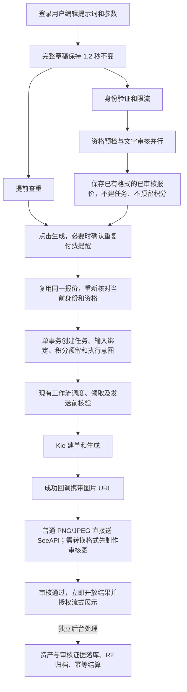

# 图片生成前的提前准备与精简查询

2026-11-16 实现与本地验证记录。这里描述代码行为；发布状态以对应提交的构建、部署记录为准，不将本地验证当作新版本线上耗时结论。
旧样本的 3.316 秒文字审核、4.503 秒建任务和 4.490 秒调度区间见
[耗时调查](./image-latency-investigation-2026-11-16.md)。

## 客户链路

1.2 秒是草稿的静止等待，不是每次点击后额外等待。用户提前点击时，复用已经在途的准备请求；尚未开始准备时直接走提交中的资格与文字审核并行路径。已经完成准备且仍有效的输入不再重复文字送审。

本轮提前报价接入登录用户的 `GenerationForm`；游客仍使用原来的试用提交入口。图片上传时的既有后台审核保持不变。准备请求本身也经过受保护接口的身份验证；提交请求仍需确认当前身份，不能将先前登录状态当作永久授权。

输出部分沿用本地已完成的[成功回调与先展示改造](./kie-image-success-callback-2026-11-16.md)：GIF 使用最多九帧拼接审核图；SVG/WebP 等转换复用已有处理。通过后的展示不等待资产导入、R2 或结算；游客仍保留水印。后台恢复与审核轮询不依赖 SeeAPI 回调一定及时到达。

## 本轮减少的等待和重复工作

- 提示词查重提前进行，结果按用户和完整提示词短暂复用 15 秒；点击时保留重复付费提醒。
- 文字审核移到用户编辑间隙，且与资格预检并行。两者均成功才保存报价；资格失败不会创建任务或预留积分。并行意味着资格失败的请求也可能已发出一次文字审核，仍受原账号限流限制。
- 复用已有报价和提交身份，不增加新表、开关或另一套准备状态。准备键与正式提交键一致，并绑定账号、完整输入、价格、资金来源和引用。
- 已有足够积分的用户跳过登录赠送补发检查。CREDITS 余额不足才走既有补发恢复；登录与余额接口的赠送行为未改变。
- 建任务在存储锁后复用同一次有效订阅读取，供资格和存储上限共同使用；时间来自当前数据库时钟。ROOT 编辑根资产与输入资产共用一份读取结果。
- 调度读取只取路由所需字段，去掉这里重复的数据库停用检查，以及领取任务时未使用的资产集合读取。真正领取和发送前仍检查当前开关、资产审核和同一提交身份。

没有把数据库事务中的多个 SQL 包进 `Promise.all` 来冒充并行；事务仍使用单连接。报价、额度、资产有效期与当前权限需要在正式提交时核对，准备阶段不扣积分、不执行生成。

## 失效和恢复

- 更换账号或修改草稿后，不得用旧准备结果提交新内容；上传未就绪、隐藏的表单以及明显无额度/资格的选择不启动自动准备。
- 已接受任务的原草稿不自动再准备；用户修改后的新草稿正常准备。
- 已知过期且未提交的报价可刷新；已提交但结果未知的请求保留原身份，不能通过更换键再次付费建单。
- 准备丢响应时，点击仍用原身份恢复；并发准备的唯一键冲突只能读回指纹完全匹配的报价。
- 供应商文字审核身份同时绑定报价、用户、审核规则和完整提示词；并发请求即使误用同一个报价键，也不能让不同文字复用审核结果。重试时变化的报价到期时间不另建文字审核身份。
- 并行资格与审核在请求退出前均等待结束，避免释放请求数据库后继续使用它。

## 验证边界

使用与改动有关的 API、表单、任务调度单元测试和隔离本地 PostgreSQL 检查，覆盖准备复用、草稿变化、账号切换、丢响应、过期、有效订阅与存储上限、资产权限、并发派单、停用开关及未知提交不重放。未运行无关全站 E2E，也未产生真实供应商生成费用。

本地结果：API 231 项、表单与提交 Hook 100 项、数据库单元检查 88 项、任务调度单元检查 30 项通过；真实 PostgreSQL 准入与编辑 39 项、发送前保护 11 项、定向调度并发检查 9 项通过。API、SaaS、database、jobs 类型检查和改动文件的格式/lint 检查通过。临时 PostgreSQL 容器在验收后删除，未修改业务数据库。

旧样本不能用来直接计算新版本必然节省的秒数。主要收益是将文字审核和查重提前、资格审核重叠执行，以及减少重复数据库访问；实际点击到 Kie 建单和客户可见时间需部署后用新样本测量。
