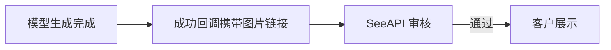
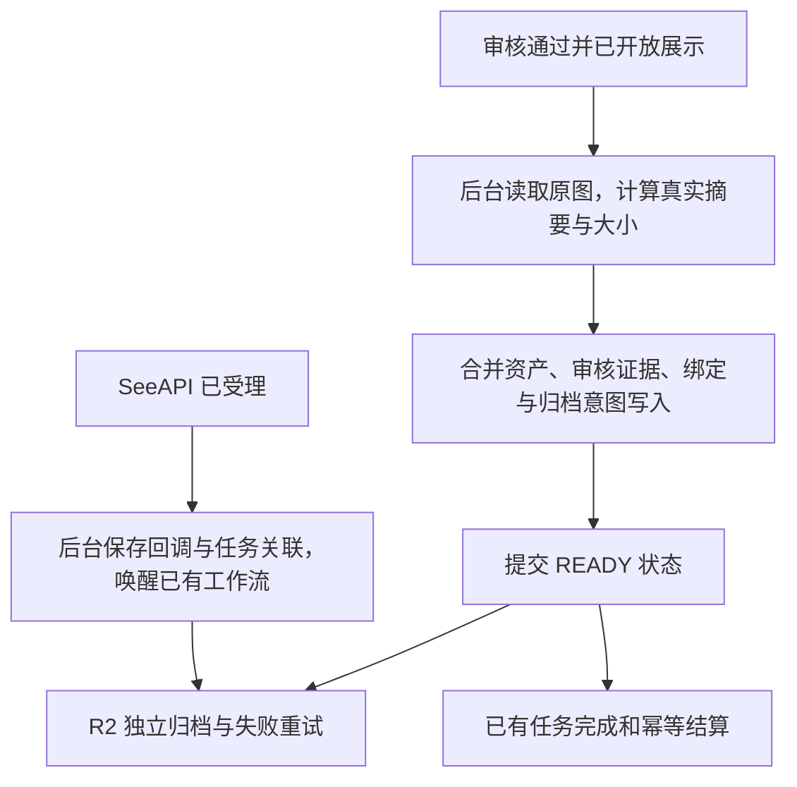

# Kie image success callbacks

Owner decision, 2026-11-16: use complete successful image callback URLs without a
second Kie result confirmation. Verify Kie's official task/time HMAC locally, and
retain the existing attempt-bound URL token. This change does not turn a provider
success into a SeeAPI content approval.

## Source evidence

The following official `onImageGenerated` success examples contain
`data.resultJson`, a JSON string with a `resultUrls` array:

| Model                   | Official reference                                       |
| ----------------------- | -------------------------------------------------------- |
| MiniMax H3 image edit   | <https://docs.kie.ai/market/minimax-h3/image-edit>       |
| Nano Banana 2 Lite      | <https://docs.kie.ai/market/google/nano-banana-2-lite>   |
| Seedream 5.5 image edit | <https://docs.kie.ai/market/seedream/5-5-image-to-image> |

These are provider documentation examples checked on 2026-11-16, not captured
production callback payloads. Historical image notices stored task identity only,
so their discarded body URLs cannot be reconstructed. GPT Image 2.6 Flare's page
recommends callbacks but did not expose a callback result example in the fetched
page; it is not counted as an independently verified success example here.

The [official signature contract](https://docs.kie.ai/common-api/webhook-verification)
is Base64 HMAC-SHA256 of `taskId.timestampSeconds`. It does not sign the result
body. Trusting the successful image body is the explicit owner decision, not a
stronger guarantee supplied by HMAC. Video and failed-image billing verification
keep their existing authenticated retrieval policy.

## Implemented receiver behavior

- Reuse `KIE_WEBHOOK_SECRET`, already used by video. The production website's
  secret metadata confirmed this binding exists; this does not prove its value or
  a real image callback signature. No credentials were changed or displayed.
- Validate the local attempt token, bounded body and consistent task IDs, then
  the official timestamp and signature. Configured receivers reject missing or
  invalid HMAC headers before database access. Timestamp tolerance remains the
  existing video policy: at most 300 seconds old or 30 seconds ahead.
- With both checks passed, accept `code=200`, `state=success` and exactly one
  HTTPS output on the configured provider host allowlist. Require the callback
  model to match the stored image attempt. Failures, missing or ambiguous results
  retain query recovery. A receiver without the official key remains query-only.
- Store only the successful output URL, model/task identity, receipt time,
  callback provenance and valid optional `creditsConsumed`. Reported provider cost
  uses the same conversion as the Kie query adapter and cannot reduce a previously
  recorded cost. Missing/invalid costs remain unknown, not zero. Do not retain the
  echoed prompt or input URLs, or use callback amounts to change frozen customer billing.
- Background callback persistence uses one transaction with **two business SQL statements**: lock/read
  the attempt and job together; then combine inbox persistence, due-time update
  and phase-owner projection. BEGIN/isolation/COMMIT are additional transaction
  protocol operations, not included in that count.
- A complete result may upgrade a previous incomplete notice once. Duplicate
  complete callbacks cannot replace its URL, reset a consumed notice or steal an
  active processing lease. The immediate due marker is epoch, avoiding extra
  delay when application and database clocks differ.
- The existing claim statement joins the private callback result in the same
  read. Normal successful execution skips both `Kie.retrieve` and normalization
  of a second response. Recovery after a claimed worker dies reuses the same
  stored result. Early callbacks do not establish provider acceptance; they wait
  for the actual submission to bind the matching task. Manual recovery stays held.

## Actual display chain

New submissions sign a V2 callback context containing the existing job, owner,
attempt, model, selected format and expiry. It is authenticated locally alongside
the official Kie signature; it needs no database lookup to submit review. Normal
PNG/JPEG URLs go straight to SeeAPI. No source GET/HEAD, thumbnail, full-file digest,
output registration, Kie GET or R2 write precedes that POST. GIF/SVG/WebP use the
existing thumbnail converter, including the bounded nine-frame GIF contact sheet.
A terminal authenticated `MEDIA_INVALID` for a direct URL can use the same converter;
unknown submission, content rejection and unrelated technical failures cannot.

SeeAPI's deterministic idempotency key handles callback replay without a pre-POST
database fence. An accepted task is saved in the private per-job delivery hub.
The request queries it after the first two-second minimum and then at least every
one second, respecting longer Retry-After within a bounded short-poll window. Ordinary completion does not wait for
the slower SeeAPI webhook. The original image Workflow is the durable query-only
recovery path after the short request lifetime ends.

An authenticated complete ALLOW publishes a private short-lived review receipt
and a URL-free notification. Result readers can return a private signed original
before its MediaAsset/READY transaction completes. They still check the current
accepted job, owner or exact guest grant, task, deletion, re-review and expiry.
The receipt freezes both review rule and policy version. The original URL is deliberately trusted to remain stable, as authorized by the
owner; this is not a claim of cryptographic byte equality. No URL hash is stored
as an image checksum.

`/api/media/original` GET/HEAD goes directly through the canonical website Worker
and existing request scope, avoiding OpenNext. Its one current-authority SQL read runs
after source headers are ready (after watermarking for guests), so revocation during
source setup denies delivery without adding a second database read. The new receipt path streams the
approved provider original without waiting for the complete body or its SHA-256.
Guest delivery still produces the required watermark. Browser preview, download
and edit actions use the approved result; edit actions can materialize the input
reference on demand without R2 completion, another review or settlement.

## Background storage and accounting

None of these background operations is awaited by the approval publication.
The importer combines metadata/evidence/binding/archive intent in one write
statement and then performs the final READY update in the same transaction. The
existing database READY trigger requires that final statement to observe the
already-written approval; changing it would not improve customer visibility.
The importer does not mutate the ledger, release reservations, or grant access to
other owners. Existing first-generation pending review can adopt the exact same
authenticated SeeAPI task; deletion, re-review and conflicting history deny it.

Source byte hashes are computed after approval and retained for archive integrity
and existing input/accounting readers. Audit provenance identifies URL review and
subsequent byte inspection separately. Archive leases, quota, retention and
financial idempotency keep their existing owners. Old and incomplete callbacks
retain query recovery. Accepted direct reviews retain their request marker so a
recovering worker adopts the same task/key instead of issuing a random-key review.
An authenticated invalid-media conversion retains its original failed task and
machine-code evidence alongside the converted review. Persisted image approval
keeps the existing no-calendar-expiry policy; only transport receipts and signed
URLs have the new short lifetime, while guest retention remains unchanged.

## Rollout and verification boundary

No database migration, secret rotation or additional feature switch is introduced.
Use the existing provider-original delivery setting and existing Kie/SeeAPI keys.
Deploy the delivery-hub receiver and all receipt consumers first, then the updated
jobs/website producers. Older jobs keep V1 callbacks; new jobs carry signed V2
context plus a persisted `directOutputReview` marker. On rollback stop new
producers and retain the receipt, original gateway, and marked-attempt consumers
until accepted tasks and signed URLs drain.

For the two existing Git build targets, deploy the website receiver/readers first
while the old jobs Worker continues to produce V1 callbacks. Its missing-receipt
reads safely use the existing asset path. Then deploy the jobs Worker, which
updates its delivery-hub receiver and V2 producers together. Cancel the first
automatically queued jobs build while the website deploys, then launch the jobs
build for that same commit after the website version is confirmed. Keep the Git
trigger filters unchanged. Do not stop live generation or alter runtime feature
settings for this sequencing.

Focused local checks include direct-URL operation order, special-format conversion,
deterministic replay, approval while database work is blocked, immediate streamed
access, deletion denial, real PostgreSQL import/idempotency, and real workerd
delivery persistence/eviction/expiry. Existing callback, archive and settlement
checks are retained. Local checks do not certify deployment or production latency.
The measured 1.38 seconds was model completion to callback ingress, not a prediction
for the complete review/display chain. Do not promise 11.3 seconds becomes 1.38.

Final local verification on 2026-11-16: 315 focused checks passed across jobs/API,
editor/guest hooks, real PostgreSQL import/recovery/settlement/edit admission, and
the real workerd delivery hub. The Chromium comparison-stability run passed all
24 assertions and closed its browser/server. Changed-file lint/format/diff checks and
config/database/jobs/API/workflows/SaaS type checks passed. This does not include a
new production build, Git publication, deployment, or paid live generation.
