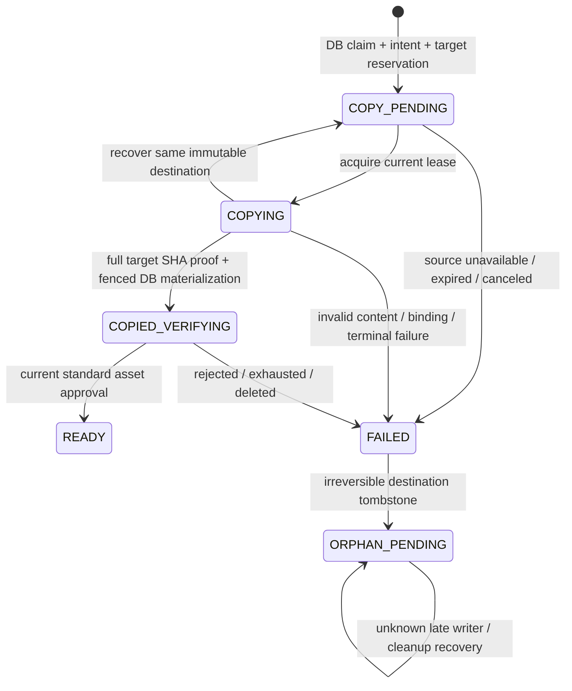

# PR29：以新账户对象的已验证复制替代同 key 归属升级

本文件保存经批准的设计；实现与验证现状以 `docs/operations/account-input-copy-validation.md` 为准。最初只读设计基线：`/workspace/ez-image-ai-guest-account-boundaries`，`0ebcec53e228f006379e8240e5bb327b0b03d82a`。设计阶段未改仓库、未 push、未访问生产或付费模型。旧删除 I/O 的不完整排空证据以 `/workspace/workflow-delete-drain-readonly-2026-10-19.md` 为准；新 Worker 流量 100% 不能补足该证明。

## 建议先行

采用**新 MediaAsset ID + 新不可变账户 key + 持久化复制 intent**。保持游客源资产、原 key、预留、到期删除事件不变；账户材料验证后才切换 draft 的 sourceAssetId。旧删除继续完成也只能命中旧 key。若复制前源已消失则明确失败，让用户重新上传，不返回一个假 READY 资产。

首版可不增加表：现有 `OutboxEvent.eventType:String / payload:Json / dedupeKey` 足以保存有版本的 intent；执行 lease 放在业务 payload，与通用投递 lease 分离，目标使用既有 MediaAsset 和 StorageUsageReservation。应写独立、严格的 DB helper 与 payload schema；不把流程状态塞进报价、审核结果、积分字段或媒体输入快照。若后续需要复杂关系查询、通用复制功能或清理 Outbox 历史，届时独立 CopyIntent 表更清楚，但不是此最小首版的前置迁移。

保留 `ACCOUNT_INPUT_PROMOTION_ENABLED=false`；新路径用另一个默认关闭的 `ACCOUNT_INPUT_COPY_ENABLED`。这样旧网站版本即使存在，也不会因新开关获得同 key 升级权限。正式放开只要求新协议的 API/任务消费者实际部署兼容、验证通过，不再依赖旧 guest 删除 I/O 全部排空。

## 当前边界

- `database/.../drafts.ts:290` 先条件占有 ACTIVE draft，`:322` 调 ownership transfer；注册账户的 guest-link 分支在 `guest-link.ts:163` 持有 guest-owner fence，`:185` 转移未生成 draft。现 `drafts.ts:391` 把原资产与预留搬给新 owner，`:426` 调同 key retention patch。这一段应在新 copy 路径改为创建 intent，不能继续调用原资产转移。
- 原 `account-input-promotion.ts:4` 仅清除同一资产的 deadline，因此无法保护被旧执行者拿到的旧对象键。
- `temporary-references.ts:75` 的 adopt 仅在原 temporary key 建 VERIFYING asset，不是复制协议，也没有把素材变成永久账户对象。
- `getClaimedGenerationDraft` (`drafts.ts:634`) 和 SUBMITTED replay (`:286`) 当前会直接返回 input；必须识别未完成复制并返回准备状态，不能让另一个恢复入口绕过等待。
- `RegisteredEditor.tsx:124` 消费 claimed draft，`app/draft/continue/route.ts:47` 依赖 claim 返回 id，`complete-guest-link-intent.ts:22` 的 DRAFT/RESULT 输出是 strict union。这些都要显式支持 PENDING，不能把 pending 当“丢失 source 后的 text-to-image”恢复。

## 最小状态机

业务 phase 使用有版本的服务端 Outbox payload；Outbox 的 PENDING/LEASED/PROCESSED 仍只表示投递状态，不能用它们代替素材审核状态。

1. **DB-only claim。** 重新检查注册身份、claim/link owner、draft/source 未过期、INPUT、尚无 guest trial/job binding/其他 live draft 等原独占条件。guest-link 沿用 guest-owner promotion fence；普通 ACTIVE claim 用条件占有。源若仍 VERIFYING 可报告 PENDING，只有源通过现有审核才开始复制；REJECT/终态不能当待审一直等。创建固定 intent（按 draft+账户 dedupe）、新 target asset/key、账户 storage reservation、复制 Outbox；保留游客源的 owner/key/reservation/deadline/cleanup。claim API 不做 HEAD/GET/copy，也不持事务跨 I/O。
2. **Worker copy。** 只凭 promotionId 读服务端 intent，使用当前 lease token。source ID/key/checksum/size/MIME/verification generation 与 target ID/key/owner 都来自冻结 DB 身份，客户端不能传 key 或 URL。先保存目标和 MPU 信息，再做外部复制。普通超时/重试恢复**同一**目标 key，不随机另建副本；只有明确终止的旧 intent 不再可用，后续新操作才用全新目标身份。
3. **物理完成后的短 DB commit。** 校验当前 token、未终止 intent、已占有且绑定正确的 draft、源身份和有效业务窗口、目标 UPLOADING/未删，以及完整目标证据。原子写 target checksum/ETag/version/finalizedAt、UPLOADING→VERIFYING、reservation→COMMITTED、draft.assetId→新 target，并发出标准 MEDIA_ASSET_VERIFY。这是材料落库，**不是 APPROVED**。存储成功但 DB 响应丢失时，下次先核验已有目标再重做该幂等 commit；绝不回退使用游客 key。
4. **审核。** 复用现有资产审核 worker/证据校验。首版不要把旧 asset 的 moderation task/result 直接抄成新 asset 的 APPROVED；新 asset ID 的标准审核绑定要完整成立。仅 `hasCurrentApprovedMediaAssetEvidence` (`assets.ts:56`) 满足最新 checksum/generation/provider/rule/policy/validUntil 才能 READY。PENDING/REVIEW/ERROR 沿现有规则处理，无 60 秒自动放行。
5. **Poll/UI。** 新 owner-scoped `getAccountInputCopyStatus({draftId|promotionId})` 只读 DB，返回 PENDING_COPY / REVIEWING / READY / FAILED / EXPIRED 和可公开错误码，READY 才附带正常 claimed-draft input。不得返回原私有 key。页面刷新及 claim replay 都能恢复此状态。等待时保留 prompt/settings，禁用真正提交，显示“正在保存/审核原图”；轮询达到前台边界可停止并提供重查。不得在后台悄悄生成/扣费或把缺源转换为文生图。用户生成请求在 READY 前不能创建 job/reserve credits；READY 后仍走现有完整 quote/owner/debt/storage/file/moderation/credit 幂等准入。

业务窗口要明确写入实现：沿原 draft/source 到期边界判定复制是否仍允许启动/落库；在该窗口中未拿到完整副本就返回 EXPIRED，不默默延长游客授权。副本已被短事务合法物化后，其独立 ACCOUNT 审核与保存遵循账户流程；以后源删除不影响它。此处不更改任何游客 RESULT 到期规则。

复制任务在 COPIED_VERIFYING 后可完成它的 Outbox 投递；该 PROCESSED 不等于业务 READY。状态查询从目标当前审核状态派生，标准验证 recovery 继续负责审核重试；小型 copy reconciler 负责将终态记录为 READY/FAILED 并触发需要的孤儿回收。新 intent 的安全字段仍保留，不能随投递完成清掉。针对 copy 目标的审核失败/取消回收，需在发 cleanup 前持久化不可复活约束；应在 runtime 的终态记录/重审 claim 边界接入同一 copy helper，而不是只在浏览器轮询时补做。现 runtime.ts:1951 的 allowQuarantinedReverification 等入口不得复活已回收的 copy 目标。

## 并发和回收的硬边界

- 用现有 draft 条件占有防两个账户抢同一 draft；每个逻辑 intent 只有固定 target 身份、固定冻结源，dedupe 不能仅按客户端 request key。另一个 owner 的 poll、replay、worker commit 都失败。
- 使用 asset-binding advisory lock 和资产 row lock；含 source 和 target 时按 assetId 排序。新 helper 的锁顺序须与现有 claim 保持一致：guest-owner（仅 guest-link 最外层）→ draft 占有/row → storage owner（涉及多个时排序）→ asset-binding/rows → intent CAS。现 `drafts.ts:290` 在 storage/asset 前更新 draft；不能让新 worker 反过来先锁 asset 再等待 draft。Outbox 通用 claim 的短事务先结束再执行，不跨 I/O 持锁。
- lease 到期只允许换执行者，不能证明旧 I/O 已停止。旧 actor 可写成同一已批准字节，但没有当前 token 就不能改 DB。条件写冲突必须完整读取目标验证；错误 bytes 的既有 key 只能报错/隔离，不能覆盖修补。
- 一旦取消/失败要清理 target，先在短事务里把该目标不可逆标 DELETED/intent terminal，并使之后的所有 commit、审核回调、人工 reverify 都不能复活它，之后才发精确 target-key cleanup。任何已经会被 cleanup 的目标身份不能在另一个成功 intent 中重用。这样即使清理任务由旧通用删除器完成，也不可能误删后来获准的活对象。
- 原游客 cleanup 事件永远只含原 source/staging/MPU keys；不要把新 account key 加进那一组。不能直接用 `cleanupUploadPromotion` 把 source 当 staging 清掉。新副本是新增物理字节，要有独立账户 reservation，原游客 reservation 仍到原清理完成才释放。
- 新 reservation 可以采用严格绑定的新前缀；现 generic cleanup 出口只认可 generation-output/media-draft (`runtime.ts:1205`) 且定向投递又有自己的校验，不能只塞任意 referenceKey。最小实现可写独立 orphan helper 从 intent 取确切 reservation/target 身份，或统一扩展两个受限校验；不能放宽成任意 referenceKey 释放。
- **晚写仍需持久化回收。** CreateMPU→写入 callback 有崩溃窗口；按 exact key 列出旧 MPU，先快照 ID，再 CAS/renew fence，然后仅 abort 该快照，复用 `complete-upload-session.ts:240` 的模式。写入超时/进程丢失时，不能因 lease 过期或一次 DELETE receipt 就宣布永远干净：晚 Complete/PUT 可能又创建孤儿。保持 terminal intent/key 的 unresolved-I/O 状态，周期重查/abort/delete；cleanup 成功回执只证明该次操作。无法证明晚 writer 结束时，公开状态可失败，但运维回收仍保留待核查，预留不能盲放。这不再威胁已提交账户对象，但仍是必须实现的孤儿/容量账务边界。

## 可复用存储原语

推荐小 adapter 调 `packages/storage/provider/s3/index.ts:389` 的 `promoteStagedObject`：传不同 source/destination，强制 DB 冻结的 `expectedSha256`，`acceptExistingFinalIdentity=false`，保留默认 multipart + full destination GET。其 `IfNoneMatch:*` 防覆盖，已有目标与 409/412 恢复会校验真实 bytes；不删除 source。不要用 `preferSinglePut=true` 的成功不回读优化作为首版验证；HEAD 的 ETag/自报 metadata 也不能代替完整 SHA。source GET 当前无 IfMatch/VersionId，因此冻结 expected SHA 不可省。

MPU-created callback 可保存 uploadId，但并不能消灭创建先于持久化的崩溃窗。详细证据、限制和接口行号见 `/tmp/ezimage-pr29-copy-primitives-review.md`。

## 文件与接线范围

- DB：新增 `queries/media/account-input-copy.ts`（严格 intent schema、create/lease/record-MPU/materialize/status/cancel/recover）；调整 `drafts.ts` 两个注册 claim 入口及 SUBMITTED replay/getClaimed；`guest-link.ts` 仅 DRAFT 分支接入；barrel export。不修改 RESULT grant 分支。
- Jobs：新增 `handlers/account-input-copy.ts`，runtime dependencies 与 copy 目标终态/重审 guard（见上），contracts 与 `packages/jobs/index.ts`；`orchestration/registry.ts` strict task payload/definition，executor switch，worker-executors 显式 heavy；orphan/recovery 为 maintenance。大字节 copy 不能在 maintenance 的 triggerAndWait 内联：`assertWorkerInlineTask` 只许 maintenance→maintenance，copy 走 trigger 的跨 lane requireCompletion 路径。
- Outbox：`deliver-outbox-event.ts:21` 新 string event→copy task；如果 claim 后用 `media-deliver-events` 定向唤醒，要扩 DB `outbox.ts:35` 的 eventIds allowlist，否则仅周期投递能够看到它。保留 outbox 完成前需要任务 ACK 的合同。
- API：claim-generation-draft / complete-guest-link-intent 的 DRAFT 返回准备态，新 protected status procedure/router，继续清理敏感 claim cookie；后续凭 owner+draft/intent 恢复，不依赖已经清除的 guest token。
- SaaS：draft/continue route、RegisteredEditor、恢复 hooks/界面和提交 gate；保持刷新可恢复，不丢 prompt/settings，不自动改成无图生成；Next 改动先读其 AGENTS 与相关本地文档。

## 必要回归

1. Mock/domain：两条 claim 入口、同/异 owner 重放、原字段变化、trial/job binding、过期/拒审、客户端 key 注入；复制过程中不得返回可生成 input，所有恢复入口不能回退 old key；无 job/积分/免费次数变动。
2. Storage：冻结 SHA 不同但 MIME/大小相同也拒；existing target 完整校验、404 与 403/timeout 区分、409/412 winner；存储成功 DB 失败、丢响应后同 key 恢复、MPU callback 失败与零 part 崩溃；不删除源。
3. 真 PG：两账户抢 draft；重复 claim 只有一 intent/target/reservation；lease 过期旧 commit 拒；commit vs cancel/orphan tombstone 两顺序；source expiry/delete 与 copy commit；新资产错误 owner/审核 callback/generation 不可通过；容量预留不会重复、无确认物理清理不释放。
4. MinIO：挂住旧 source DELETE，完成新 key copy+commit/审核模拟后放开旧 DELETE，新目标内容仍在且 hash 一致；复制途中源先删→明确失败；旧 copy actor 在 terminal cleanup 后才完成→DB 不可复活且 reaper 后续再发现/清理；成功账户目标永不落入 orphan key 集合。
5. UI/RPC：PENDING→REVIEWING→READY、失败/超时重查、页面刷新、同登录不同账户、禁止等待时生成、RESULT 路径水印/expiry/grant 完全不变。Jobs 与 MinIO scripts 使用显式套件清单，新增文件要注册。

现有最贴近的套件：DB `account-input-retention.integration.test.ts:124/204`、`draft-storage.integration.test.ts`、`guest-link.integration.test.ts:310`、`upload-finalization.integration.test.ts:109/319/377`；storage `immutable-upload.minio.integration.test.ts:200` 已有旧 key delete/新 key 存活基础，`:262` 并发 winner，`:330` 零 part MPU。

最初设计阶段仅现有 mocked storage 两套件 **23/23** 通过；后续实现与真 PG 回归见验证报告，仍无真实 MinIO/生产验证；官方 Prisma client 缺失仍阻止本地 genuine ORM 套件，不绕过下载或造 client。方案不阻塞 PR34，也不作为打开 PR29 旧同 key flag 的依据。
